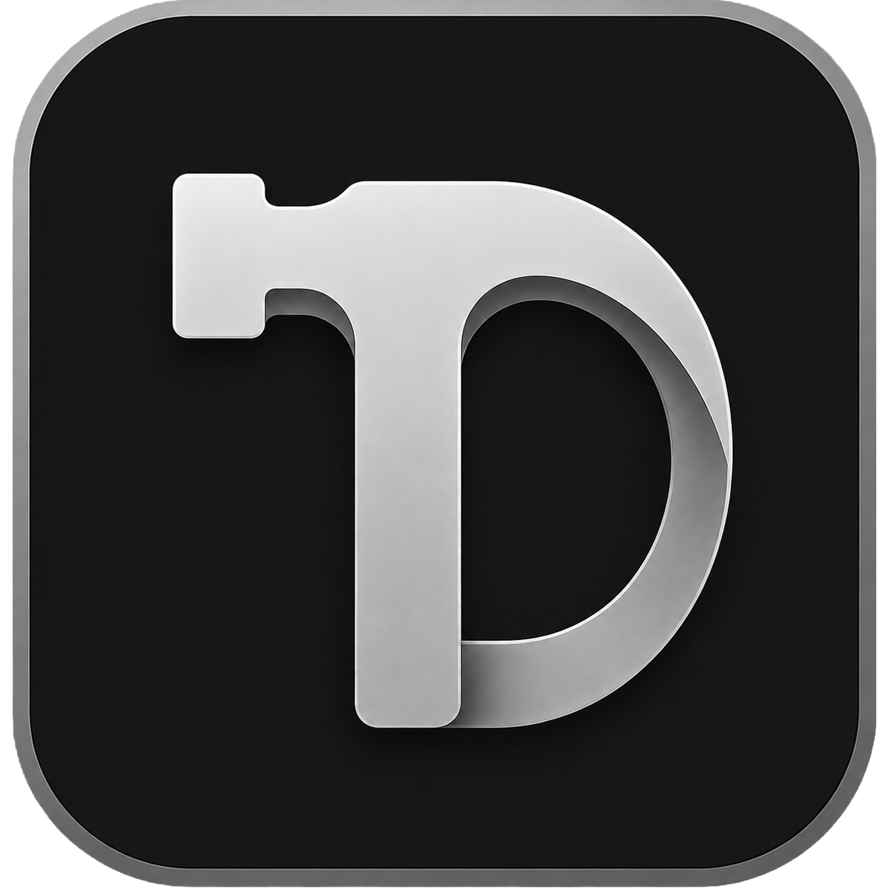

<p align="center">
  
</p>

# ToolDock

[](README.md)
[](README.es.md)

Un lanzador tipo dock para Windows que complementa la barra de tareas con sus propios accesos, posición, apariencia y comportamiento.

Es una aplicación de escritorio en C# y WPF (.NET 9), pensada para usarse en portable: un `.exe` en su propia carpeta, sin instalador y sin escribir en el Registro de Windows. Coloca el ejecutable en una carpeta propia. Los archivos de configuración se escriben junto a él, así los datos quedan separados y puedes copiar o mover esa carpeta a otro equipo.

> ToolDock sigue en desarrollo. Pueden quedar errores o comportamientos inestables.

## Algunos comportamientos

Estos clips son solo una muestra. ToolDock es muy personalizable: la posición, la apariencia, los accesos y el comportamiento se cambian desde Configuración.

### Arrastrar y soltar accesos

Arrastra un `.exe` o un `.lnk` desde el Explorador y suéltalo en el dock para agregarlo.


### Posición del dock

Ancla el dock al borde superior, inferior, izquierdo o derecho de la pantalla. En los laterales pasa a una disposición vertical.


### Autoocultar

El dock puede esconderse en su borde y volver cuando el cursor se acerca o toca el borde de la pantalla, según el modo elegido. También puede quedarse visible hasta que una ventana de esa pantalla se maximice o una ventana se superponga al dock.


### Reservar espacio en el área de trabajo

El dock puede reservar espacio en el escritorio, como la barra de tareas, para que las ventanas maximizadas se detengan junto a él en lugar de cubrirlo.


### Abrir las apps en la pantalla del dock

Al abrir un acceso, esa ventana puede moverse a la pantalla donde está el dock.


## Qué incluye

- Anclaje a los cuatro bordes, con orientación vertical en izquierda y derecha.
- Accesos a `.exe`, `.lnk` y aplicaciones de Microsoft Store (UWP).
- Reordenar, bloquear el orden, icono personalizado y efecto de ampliación al pasar el cursor.
- Color, opacidad, contorno por lado, esquinas redondeadas y presets.
- Autoocultar, siempre encima, reserva del área de trabajo y ocultar sobre pantalla completa, ventanas maximizadas o superpuestas.
- Varias instancias, atajos de teclado globales e interfaz en español e inglés.


## Requisitos

- Windows 11
- Para compilar: [.NET SDK 9](https://dotnet.microsoft.com/download) o superior
- Visual Studio 2022 o posterior, opcional

## Compilar y ejecutar

Desde la carpeta `ToolDock`:

```powershell
dotnet restore
dotnet build
dotnet run
```

Publicación portable (un solo ejecutable, autocontenido, win-x64):

```powershell
dotnet publish -c Release -r win-x64 --self-contained true
```

El ejecutable queda en:

`ToolDock\bin\Release\net9.0-windows\win-x64\publish\ToolDock.exe`

Coloca ese `.exe` en una carpeta dedicada. La configuración se crea junto a él.

Ejecuta las comprobaciones de regresión desde la raíz del repositorio:

```powershell
dotnet run --project tests/ToolDock.RegressionTests
```

## Uso rápido

1. Ejecuta `ToolDock.exe`.
2. Clic derecho en el icono de la bandeja y abre **Configuración**.
3. Arrastra un `.exe` o un `.lnk` al dock, o agrégalos desde **Accesos de apps**.
4. Clic izquierdo en un icono para abrirlo. Clic derecho para quitarlo o cambiar su icono.

La guía completa está en [Docs/Español/DOCUMENTACION_USUARIO.md](Docs/Español/DOCUMENTACION_USUARIO.md).

## Documentación

| | English | Español |
|---|---|---|
| Uso | [User documentation](Docs/English/USER_DOCUMENTATION_EN.md) | [Documentación de usuario](Docs/Español/DOCUMENTACION_USUARIO.md) |
| Técnica | [Technical log](Docs/English/TECHNICAL_LOG_EN.md) | [Bitácora técnica](Docs/Español/BITACORA_TECNICA.md) |

## Datos junto al ejecutable

| Archivo | Contenido |
|---|---|
| `config.json` | Ajustes y accesos de la primera instancia |
| `config.instanceN.json` | Ajustes de la instancia N (N ≥ 2) |
| `Presets_TD.json` | Presets guardados por el usuario |
| `Colors_TD.json` | Colores personalizados |
| `Shortcuts_TD.json` | Nombre sugerido al exportar solo los accesos |
| `Backups_TD/` | Copias anteriores de las configuraciones de instancia, guardadas como `.bak` |
| `Temp_TD/` | Archivos temporales usados al guardar los ajustes |

## Arrancar al inicio

ToolDock sigue siendo portable y no se registra para arrancar automáticamente. Para abrirlo al iniciar sesión, añade un acceso directo a la carpeta de Inicio de Windows.

1. Pulsa `Win + R`, escribe `shell:startup` y acepta.
2. Coloca en esa carpeta un acceso directo a `ToolDock.exe`.

Puedes ejecutar varias instancias a la vez. Cada una guarda su configuración en la misma carpeta: la primera usa `config.json` y cada instancia adicional usa `config.instanceN.json`. Para abrir más de una al iniciar Windows, añade `--instances 2` (o `--instances=2`) al destino del acceso directo. Usa el número de instancias que quieras.

## Licencia

ToolDock se publica bajo la licencia MIT. El texto está en [LICENSE](LICENSE).
